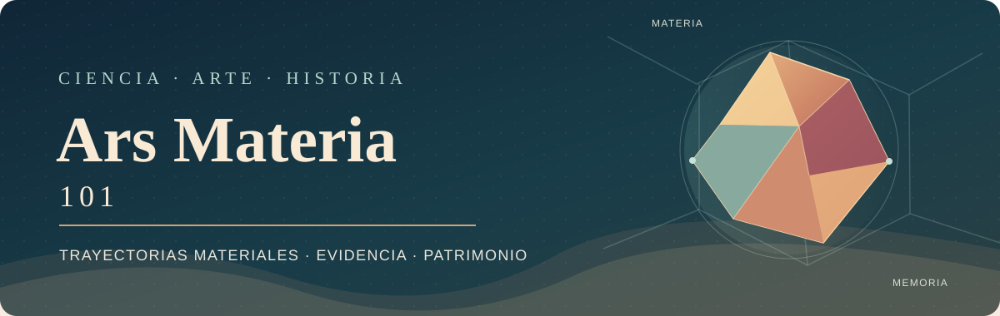
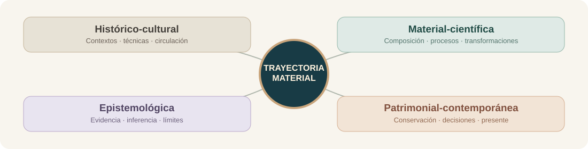

# 🧱 Ars Materia 101
## Ciencia de materiales en el arte: historias, evidencias y decisiones



**Materia · técnica · cultura · conocimiento · patrimonio**

> Toda obra tiene una historia material. Soportes, pigmentos, fibras, metales, cerámicas y transformaciones conservan huellas de decisiones humanas y procesos físicos que podemos investigar y discutir.

Bienvenido a **Ars Materia 101**, proyecto de diseño, realización y documentación pedagógica vinculado al curso universitario **CIFI 4074 · Ciencia de Materiales en el Arte**. Explora la materialidad artística desde cuatro perspectivas convergentes: **histórico-cultural, material-científica, epistemológica y patrimonial-contemporánea**.

Este repositorio **no es un Moodle instalable ni una reproducción íntegra del aula**: preserva modelos, fundamentos, decisiones, protocolos, auditorías y aprendizajes de una experiencia curricular situada.

## 🚪 Elige tu puerta de entrada

- 🎓 **Estudiantes:** [introducción a FEHE](02_ARQUITECTURA_CONCEPTUAL/FUNDAMENTOS_FEHE/CIFI4074_Ars_Materia_Introduccion_FEHE_H1-H10_Estudiante_v0.1.md), [guía de la Espiral de Casos](12_RECURSOS_ESTUDIANTE/GUIA_ESTUDIANTE_ESPIRAL_CASOS_ARS_MATERIA_v1.0_APROBADA.md) y [compendio H1–H10](12_RECURSOS_ESTUDIANTE/COMPENDIO_FEHE_H1-H10/README.md).
- 🧑‍🏫 **Docencia y diseño curricular:** [Patrón OVAt-H v1.0 validado](03_METODOLOGIA_Y_FLUJO_DE_TRABAJO/PROTOCOLOS/PATRON_OVAT_H_TRANSFERIBLE_v1.0_VALIDADO.md) y [protocolo de preproducción](03_METODOLOGIA_Y_FLUJO_DE_TRABAJO/PROTOCOLOS/PROTOCOLO_PREPRODUCCION_OVAT_H_v1.0_APROBADO.md).
- 🔬 **Investigación:** [Documento Rector FEHE (candidato)](02_ARQUITECTURA_CONCEPTUAL/DOCUMENTO_RECTOR/CIFI4074_Ars_Materia_Documento_Rector_FEHE_H1-H10_v0.9_CANDIDATO.md), [inventario de fuentes](13_INVESTIGACION_Y_EVIDENCIA/INVENTARIO_FUENTES.md) y [ruta PROEMA (candidata)](13_INVESTIGACION_Y_EVIDENCIA/PROEMA/CIFI4074_Ars_Materia_Guia_Estudiante_Ruta_PROEMA_v0.1_CANDIDATA.md).
- 🧭 **Estado y evidencias:** [Gate Integral H10](18_DOCUMENTACION_ACTIVA/GATE_INTEGRAL_H10_2026-11-02.md), [cierre documental fuerte H10](18_DOCUMENTACION_ACTIVA/CIERRE_FUERTE_CARRIL_B_H10_DEFINITIVO_Y_TRANSFERENCIA_2026-11-02.md) y [bitácora de decisiones](18_DOCUMENTACION_ACTIVA/BITACORA_DECISIONES.md).
- 🗂️ **Orientación técnica:** [mapa del repositorio](00_CONTROL_MAESTRO/MAPA_REPOSITORIO.md).

## 🌱 La pregunta que nos mueve

**¿Qué aprendemos sobre una obra cuando sus materiales se convierten en evidencia histórica, científica y cultural?**

Ars Materia permite reconstruir trayectorias materiales; conectar composición, fabricación y transformaciones con decisiones técnicas; reconocer límites de inferencia; y formular preguntas sobre circulación, conservación, uso y significado. No reduce el arte a la química: invita a que la ciencia y la historia del arte se interroguen mutuamente.

## 🔭 Cuatro perspectivas, una trayectoria material



La materialidad artística se investiga mediante perspectivas que dialogan sin sustituirse: los contextos históricos, los procesos físico-químicos, la calidad de las inferencias y las decisiones patrimoniales contemporáneas.

## 🧬 Cómo funciona

| Pieza | Función pedagógica |
|---|---|
| **FEHE** | Fundamentación histórico-epistemológica de cada unidad H: preguntas, evidencias, movimientos y límites |
| **OVAt-H** | Traducción didáctica de la FEHE a una secuencia de aprendizaje en el entorno Moodle |
| **Espiral de Casos** | Desarrollo longitudinal de un Caso Ancla elegido por el estudiante, con complejidad creciente y menor andamiaje |
| **FD1–FD5** | Hitos de la Espiral de Casos dentro de la clase |
| **PROEMA** | Trayectoria de investigación y producción longitudinal que se integra al curso sin confundirse con la Espiral |
| **Auditorías y Gates** | Evidencia, revisión situada, decisión humana y memoria de lo aprobado y lo pendiente |

### Las seis funciones del patrón OVAt-H

```text
F1 Apertura y ubicación
 → F2 Marco FEHE
 → F3 Profundización
 → F4 Actividad central y evidencia
 → F5 Transferencia y reutilización
 → F6 Cierre longitudinal
 ↺ siguiente H, con nuevas preguntas y mayor autonomía
```

Son **funciones reconocibles, no plantillas rígidas**. Cada unidad tiene su propia FEHE, diseño, realización, QA situado, auditoría inversa y decisión humana. Una integración funcional expresamente aprobada no implica omisión.

## 📍 Estado de situación

**Corte de consulta: 17 de noviembre de 2026.** El último cierre curricular integral localizado corresponde al **2 de noviembre de 2026**. Las decisiones recientes prevalecen sobre descripciones históricas que todavía figuran en documentos anteriores.

| Frente | Estado documentado |
|---|---|
| **H1** | **Aprobada como modelo operativo** |
| **H2–H9** | Gates y decisiones de aprobación documentados por unidad; consultar sus expedientes |
| **H10** | **Aprobada como sistema** · Gate Integral cerrado · **GO con condiciones no bloqueantes** |
| **Patrón OVAt-H v1.0** | **VALIDADO** en el alcance del proyecto mediante D-027 |
| **Protocolo de montaje OVAt-H v0.3** | **Piloto experimental congelado**, no validado automáticamente por el cierre de H10 |
| **Compendio FEHE H1–H10** | Guía y registro disponibles; conciliación/publicación de artefactos pendientes |
| **PROEMA** | Línea longitudinal propia; parte de su arquitectura documental permanece en revisión |
| **Transferencia metodológica** | Experiencia de origen documentada; adaptación y validación corresponden al proyecto receptor |

**Alcance de la evidencia:** la verificación final de H10 en Moodle consta **según declaración del docente**. No debe presentarse como inspección independiente del asistente, validación empírica de aprendizajes ni prueba de que todos los archivos binarios finales están archivados. Consulta el [Gate Integral H10](18_DOCUMENTACION_ACTIVA/GATE_INTEGRAL_H10_2026-11-02.md).

### Qué queda abierto

El Carril B de H10 está **cerrado documentalmente**. El trabajo pendiente no implica producir H11 ni reabrir H10 por inercia:

- Reconciliar versiones y binarios finales de Moodle con los artefactos conservados en GitHub.
- Completar procedencia, licencias, accesibilidad y trazabilidad de recursos y FD5 donde proceda.
- Resolver la discrepancia documental entre versiones descriptivas de F2 cuando corresponda.
- Evaluar carga y resultados con evidencia real de estudiantes, sin confundir aprobación de diseño con eficacia demostrada.
- Mantener diferenciadas la Espiral de Casos y PROEMA.
- Examinar transferibilidad metodológica sin otorgar al piloto v0.3 una validación que aún no posee.

El detalle y los límites están en el [cierre fuerte definitivo](18_DOCUMENTACION_ACTIVA/CIERRE_FUERTE_CARRIL_B_H10_DEFINITIVO_Y_TRANSFERENCIA_2026-11-02.md).

## 🔁 Framework, Ars Materia y Materia Mundi

Ars Materia es una **implementación curricular situada con autonomía de gobernanza** del [Framework Genérico](https://github.com/ricardojuanmorales/framework-proyecto-generico-ia-1). Su documentación organizativa original cita el **Framework V4.1.0**; el Framework publica hoy **v5.3.0**. Esta coexistencia **no significa que Ars Materia haya completado una migración** entre versiones.

La experiencia H10 sirve como referencia para el piloto de adaptación en [Materia Mundi 101](https://github.com/ricardojuanmorales/materia-mundi-101), vinculado a CIFI 3065. Allí el **Foro** es un componente visible, existe **Laboratorio integrado** y se emplea **REC**; no corresponde copiar la lógica **FD5** de Ars Materia. Cada proyecto conserva sus Gates y su propia evidencia.

```text
Framework Genérico
    ↕ principios, arquitectura y aprendizajes candidatos
Ars Materia 101 · CIFI 4074
    → experiencia situada H1–H10
    → piloto OVAt-H v0.3 como antecedente
    → Materia Mundi 101 · CIFI 3065
       adaptación y verificación propias
```

> **Transferir no es copiar. Aprobar no es demostrarlo todo. Documentar no es fabricar evidencia.**

## 🗺️ Navegar el repositorio

La macroestructura **00–21 + 99** ordena funciones documentales. Se activa cuando hace falta; no se trata de llenar carpetas por ceremonia.

| Ruta | Contenido |
|---|---|
| [00_CONTROL_MAESTRO](00_CONTROL_MAESTRO/) | Autoridad, estado, decisiones y mapas |
| [02_ARQUITECTURA_CONCEPTUAL](02_ARQUITECTURA_CONCEPTUAL/) | Fundamentación y marco FEHE |
| [03_METODOLOGIA_Y_FLUJO_DE_TRABAJO](03_METODOLOGIA_Y_FLUJO_DE_TRABAJO/) | Protocolos y patrones transferibles |
| [08_CURSOS_PROGRAMAS_Y_TRAYECTORIAS](08_CURSOS_PROGRAMAS_Y_TRAYECTORIAS/) | Prontuario, alineación y FEHE H1–H10 |
| [12_RECURSOS_ESTUDIANTE](12_RECURSOS_ESTUDIANTE/) | Guías y compendios de estudio |
| [13_INVESTIGACION_Y_EVIDENCIA](13_INVESTIGACION_Y_EVIDENCIA/) | PROEMA, fuentes e investigación |
| [18_DOCUMENTACION_ACTIVA](18_DOCUMENTACION_ACTIVA/) | Gates, auditorías, cierres y bitácoras |
| [19_IMPLEMENTACION_Y_DESPLIEGUE](19_IMPLEMENTACION_Y_DESPLIEGUE/) | Especificaciones OVAt-H y registros Moodle |
| [99_ARCHIVO_HISTORICO](99_ARCHIVO_HISTORICO/) | Antecedentes preservados |

**Fuente de verdad documental:** rama `main` de este repositorio. El proyecto ChatGPT **Ars Materia 101** funciona como espacio de análisis y coordinación; GitHub conserva el registro versionado. Las decisiones humanas, sus fechas y alcances deben leerse con sus expedientes, no deducirse del nombre de un archivo.

## 🤝 Una invitación

Si enseñas ciencias, arte o humanidades, estudias patrimonio, diseñas experiencias universitarias o investigas la relación entre materia y conocimiento, puedes explorar aquí preguntas, modelos y límites de una práctica documentada. Reutilizar un patrón exige **adaptar, justificar, revisar y conservar evidencia local**, no asumir que lo aprobado en CIFI 4074 equivale a validación universal.

**Proyecto:** Ars Materia 101 · CIFI 4074  
**Repositorio:** [ricardojuanmorales/ars-materia-101](https://github.com/ricardojuanmorales/ars-materia-101)  
**Licencia:** consulta [LICENSE](LICENSE) para los materiales cubiertos; las obras y recursos de terceros pueden conservar derechos propios.
